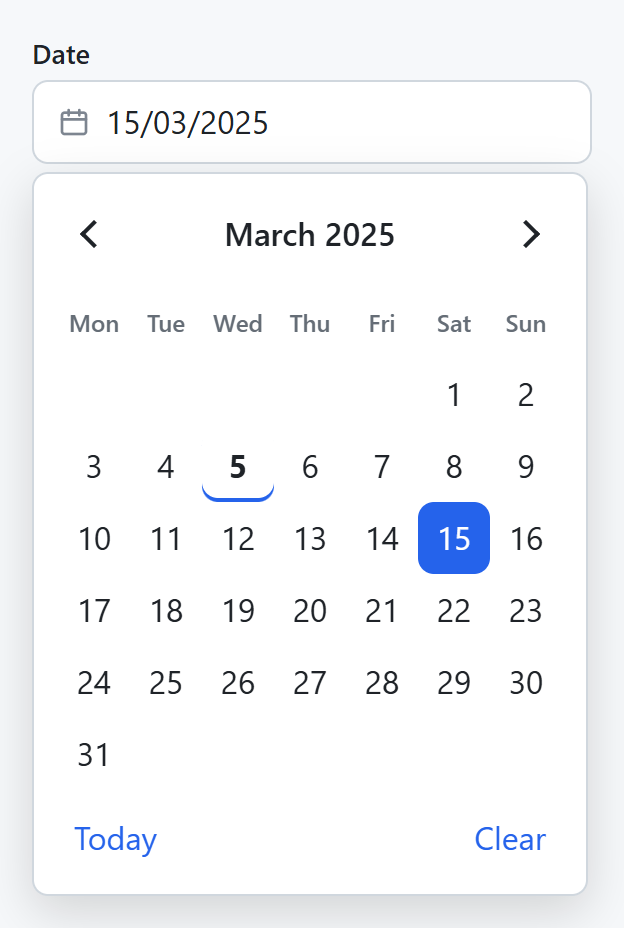
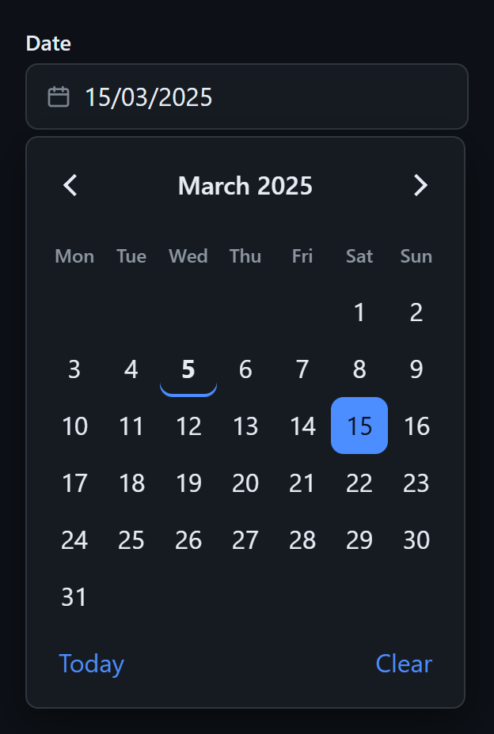
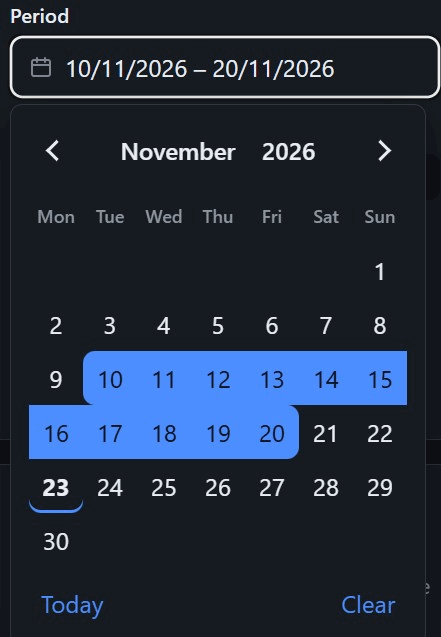
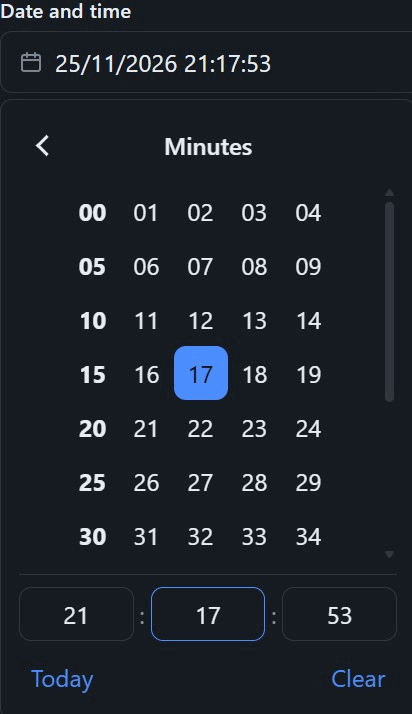

# Ten Protons Datepicker

Zero-dependency, accessible, framework-agnostic datepicker. Vanilla TypeScript + a native Web Component.

- WAI-ARIA date picker dialog pattern, full keyboard support, live-region announcements
- Single, range and multiple selection, and an optional time selector, as separate, tree-shakeable modules
- Popup or inline calendar, one or two months, `<input>` binding or a ready-made `<ten-protons-datepicker>` Web Component
- Form-associated Web Component: takes part in `<form>` submission and reset
- `min` / `max` dates, disabled dates, disabled weekdays
- Click the month or year in the header to jump straight to any month or year through a grid (keyboard, type-ahead and screen-reader friendly); navigation only, it never changes the selection
- Accepts `Date`, ISO strings (date or date-time, with or without a zone) and Unix timestamps; can report Unix timestamps back (`outputTimestamp`)
- `valueInUtc`: your backend speaks UTC, the picker shows local time, and the conversion happens inside the picker
- `Intl`-based localisation, RTL, locale-derived input format, first day of week
- Manual input that is parsed on blur / Enter and validated against min / max / disabled dates
- CSS variables, light / dark (`prefers-color-scheme` or `data-theme`), replaceable class names
- ESM only, strict TypeScript types, no runtime dependencies

**Works with any framework.** The datepicker is a standard Web Component on top of a plain TypeScript class, so it needs no framework adapter. Use it in Vue, React, Angular, Svelte, SolidJS, Lit, Alpine.js, Astro or plain HTML/JS: set attributes, listen to `change`. A Vue example is [below](#vue).

| Light | Dark | Range |
| --- | --- | --- |
|  |  |  |

```sh
npm i ten-protons-datepicker
```

## Web Component

```html
<script type="module">
  import 'ten-protons-datepicker/wc';
  import 'ten-protons-datepicker/locales/uk'; // optional UI strings for locale="uk"
</script>

<ten-protons-datepicker name="period" mode="range" locale="uk" min="2025-01-01" label="Period"></ten-protons-datepicker>
```

`<x-datepicker>` is registered as an alias for the same element, so either tag works. Prefer `ten-protons-datepicker`: `x-datepicker` is a generic name another library could also claim, and the first one registered wins.

`mode="range"` / `mode="multiple"` and `enable-time` load their module on demand, so single-date pages don't pay for them.

| Attribute | Notes |
| --- | --- |
| `value` | ISO: `2025-03-05`, range `2025-03-01/2025-03-10`, multiple `2025-03-01,2025-03-05`. Unix timestamps work too; with `output-timestamp` the property returns them. See [Unix timestamps](#unix-timestamps) |
| `name`, `placeholder`, `label`, `disabled` | `label` is the input's accessible name. Form-associated where `ElementInternals` exists |
| `mode`, `locale`, `min`, `max`, `date-format`, `first-day`, `position`, `theme` | see [Options](#options) |
| `year-range` | `1900-2100`: two integers separated by `-`, see `yearRange` in [Options](#options). Anything else is ignored (the default range) |
| `number-of-months`, `show-other-months`, `allow-input`, `close-on-select`, `disabled-days`, `output-timestamp`, `enable-time`, `value-in-utc`, `inline` | booleans: present = true, `="false"` = false |

```js
const el = document.querySelector('ten-protons-datepicker');
el.value;                       // ISO string of the current selection
el.options = { disabledDates: (d) => d.getDay() === 0, onChange: console.log };
el.addEventListener('change', (e) => console.log(e.detail)); // also: open, close, monthChange, yearChange
await el.ready;                 // resolves with the underlying Datepicker

// value, min and max are also properties: they take a Date, an ISO string or Unix seconds (null removes them)
el.min = new Date();
el.max = new Date(2026, 11, 31);
el.value = new Date();          // range / multiple: an array, el.value = [start, end]
```

The input is styled out of the box to match the calendar (border, radius and colours, light and dark, red border on invalid input). Restyle it with `::part(input)` and `::part(toggle)`, e.g. `ten-protons-datepicker::part(input) { border-radius: 0 }`. The calendar button is the web component's own icon (at the start of the field, like `showIcon` on a plain input), so `showIcon` doesn't apply to it.

### Vue

Tell Vue that the tag is a custom element (Vite: `vue({ template: { compilerOptions: { isCustomElement: (tag) => tag === 'ten-protons-datepicker' } } })`), then bind `value` and listen to `change`:

```vue
<script setup lang="ts">
  import 'ten-protons-datepicker/wc'; // its CSS is built in; enable-time loads the time module itself

  defineProps<{ modelValue: number | null }>();
  const emit = defineEmits<{ 'update:modelValue': [timestamp: number | null] }>();
  const onChange = (e: Event) => {
    const value = (e as CustomEvent).detail;
    emit('update:modelValue', typeof value === 'number' ? value : null);
  };
</script>

<template>
  <ten-protons-datepicker :value="modelValue ?? ''" label="Due" value-in-utc output-timestamp enable-time @change="onChange" />
</template>
```

Attributes such as `theme` and `max` can be bound the same way. `min`, `max` and `value` accept a `Date` as well as an ISO string or a Unix timestamp: Vue sets a property when the element has one, so `:max="maxDate"` works with a `Date` directly. Written as plain HTML attributes (`max="…"`) they are strings, so use an ISO string or a timestamp there. The element is created and destroyed with the component, so there is nothing to clean up. Other frameworks work the same: set attributes, listen to `change`.

## Imperative API

```ts
import { Datepicker } from 'ten-protons-datepicker';
import { withRange } from 'ten-protons-datepicker/range';
import 'ten-protons-datepicker/core.css';
import 'ten-protons-datepicker/themes.css';

const dp = withRange(new Datepicker(input, { locale: 'en-GB', minDate: new Date() }));

dp.addEventListener('change', (e) => console.log(e.detail)); // or onChange option
dp.setRange(start, end);
dp.getDate();    // Date | Date[] | null   (numbers with outputTimestamp)
dp.destroy();
```

Methods: `open() close() toggle() destroy() getDate() setDate(date, triggerChange?) setOptions(partial) jumpToDate(date) setRange(start, end)`.

`withMultiple` lives in `ten-protons-datepicker/multiple` and `withTime` in `ten-protons-datepicker/time`. Without the helpers, import the module for its side effect and pass `mode: 'range'` / `enableTime: true`. Selecting a mode or `enableTime` without importing its module throws a descriptive error.

With `inline: true` the calendar renders inside the given element (any element, not just an input).

### Options

| Option | Default | |
| --- | --- | --- |
| `mode` | `'single'` | `'single' \| 'range' \| 'multiple'` |
| `selected`, `defaultDate` | | initial value / month shown when empty. Same types as `minDate` (`selected` also takes an array) |
| `minDate`, `maxDate` | | `Date`, an ISO string (`2025-03-15`, or a date-time such as `2025-03-15T13:07:09`, `2025-03-15T13:07:09.724Z`, `2025-03-15T13:07:09+02:00`), or a Unix timestamp in seconds (`DateInput`; also accepted by `selected`, `setDate`). Limits compare calendar days, so the time of day is ignored; zones follow [`valueInUtc`](#utc-backends-valueinutc). An unparseable value is ignored, i.e. no limit |
| `disabledDates`, `disabledDaysOfWeek` | | `Date[]` or `(date) => boolean`; `0` = Sunday |
| `locale` | browser | BCP 47 tag or a `LocaleObject` |
| `firstDayOfWeek` | from locale | `0`–`6` |
| `dateFormat` | from locale | tokens: `yyyy yy MMMM MMM MM M dd d EEEE EEE`, quote literals: `d 'de' MMMM` |
| `inline`, `showOtherMonths`, `numberOfMonths` | `false`, `false`, `1` | `numberOfMonths: 1 \| 2` |
| `yearRange` | this year ± 100 | `[from, to]`, absolute years, both inclusive: the years the header's year grid lists. The years of `minDate` / `maxDate` replace the matching end (so `minDate: '1900-01-01'` alone lists 1900 up to this year + 100), and the list always includes the years on show. Limited to 1–9999; a reversed or invalid range is ignored. See [Month and year grids](#month-and-year-grids) |
| `position` | `'auto'` | `auto top bottom left right`; auto flips above when there is no room below |
| `theme` | auto | `'light' \| 'dark'` |
| `allowInput` | `true` | `false` makes the input read-only |
| `showIcon` | `true` | calendar icon inside the input, so it reads as a date field even without a label. `false` removes it. Needs `core.css`; the web component has its own toggle button and ignores this option |
| `closeOnSelect` | `true` (single, range), `false` (multiple, and with `enableTime`) | |
| `closeOnOutsideClick` | `true` | outside pointer-down or focus |
| `classes` | | replace any default class name (`ClassNames`) |
| `enableTime` | `false` | add an `HH:mm:ss` time selector below the calendar, see [Date & time](#date--time). Needs `ten-protons-datepicker/time` |
| `valueInUtc` | `false` | the backend works in UTC: values going in and out are UTC, the picker shows local time, see [UTC backends](#utc-backends-valueinutc) |
| `outputTimestamp` | `false` | report Unix timestamps (seconds) instead of `Date`s / ISO strings, see [Unix timestamps](#unix-timestamps) |
| `isoInput` | | input that receives the ISO value (or the timestamp with `outputTimestamp`), e.g. a hidden field |
| `anchor`, `appendTo` | input, `document.body` | construction only |
| `onChange onOpen onClose onMonthChange` | | callbacks; the same events fire as `CustomEvent`s |

`setOptions` accepts everything except `inline`, `anchor` and `appendTo`.

## Input handling

Typing is parsed on blur or Enter (ISO is always accepted). Separators are matched leniently (`5/3/2025` parses with `dd.MM.yyyy`). Range text is `start – end`, multiple is comma separated.

- Valid: the selection, calendar and `isoInput` update and `change` fires.
- Invalid, disabled or too many dates: on Enter the input is marked `aria-invalid` and keeps its text; on blur it reverts to the last valid value.
- Empty text clears the selection.

`change` also dispatches native bubbling `input` / `change` events on the input, so `v-model`-style bindings work.

## Unix timestamps

**Input is automatic, with no option.** Type or paste a Unix timestamp in seconds (9–11 digits, e.g. `1794072736`) and the picker converts it: the input shows the date in your `dateFormat` and the calendar jumps to it. Ranges and multiple dates work too (`1741996800 - 1742428800`), and timestamps are also understood in the web component's `value` attribute, in `selected` / `setDate()` / `minDate` / `maxDate` (as a number or a digit string), and in a prefilled input. Anything with fewer digits (like `20250315`) is still treated as a normal date.

**Output is opt-in with `outputTimestamp: true`** (`output-timestamp` on the web component). Everything the picker reports then uses seconds instead of `Date`s / ISO strings:

| | `outputTimestamp: false` (default) | `outputTimestamp: true` |
| --- | --- | --- |
| `getDate()`, `onChange`, `change` event `detail` | `Date` / `Date[]` / `null` | `number` / `number[]` / `null` |
| `isoInput` value, web component `value` and form value | `2025-03-15`, `2025-03-10/2025-03-20` | `1741996800`, `1741996800/1742428800` |
| text shown in the input | formatted with `dateFormat` | formatted with `dateFormat` (unchanged) |

All four combinations work:

```ts
const dp = new Datepicker(input, { dateFormat: 'dd.MM.yyyy', outputTimestamp: true, onChange: (ts) => save(ts) });

// timestamp -> timestamp   input "1794072736"   shows 07.11.2026, getDate() = 1794009600
// formatted -> timestamp   input "07.11.2026"   shows 07.11.2026, getDate() = 1794009600
// with outputTimestamp: false (default):
// timestamp -> date        input "1794072736"   shows 07.11.2026, getDate() = Date(2026-11-07)
// formatted -> date        input "07.11.2026"   shows 07.11.2026, getDate() = Date(2026-11-07)
```

(Values shown for a browser in UTC; elsewhere the output is that zone's local midnight of 7 November, e.g. `1794002400` in Europe/Kyiv.)

Things to know:

- **Day granularity (without `enableTime`).** A date-only picker selects days, not instants; with [`enableTime`](#date--time) the time of day is kept too. A timestamp is converted to the **local** calendar day it falls on, and the timestamp that comes out is the **local midnight** of that day. So `timestamp -> timestamp` normalises the time of day (`1794072736` comes back as `1794009600`), and it is stable from then on: feeding the output back in gives the same value.
- **Time zones.** "Local" is the browser's time zone, in line with the rest of the picker. A timestamp for UTC midnight (`1741996800` = 2025-03-15T00:00Z) is still March 14 in New York. If your backend stores UTC-midnight timestamps for plain dates, set [`valueInUtc`](#utc-backends-valueinutc): `1741996800` is then 15 March in every time zone.
- **Seconds only.** Millisecond timestamps (13 digits) are not recognised.
- **Before 1970.** `outputTimestamp` reports negative seconds for earlier dates, and a negative `number` passed to `selected` / `setDate()` / `minDate` / `maxDate` is understood. Text and strings are not. Typed text containing a negative timestamp (`-1000000000` at the start, or right after a `,` or `;`) is **rejected as invalid** like any other invalid input (`aria-invalid` on Enter, reverted on blur), and a `-123456789` string given to `selected` or the web component's `value` is ignored. A dash between two timestamps is still the range separator (`1741996800 - 1742428800` and `1741996800-1742428800` both work). Typed dates (`01.01.1900`) and ISO strings (`1900-01-01`) work for any year from 1 to 9999; feed such values back as ISO or `Date`, not as typed timestamps.
- **Types.** `DatepickerValue` is `Date | Date[] | number | number[] | null`; narrow it with `typeof` / `instanceof` or check `outputTimestamp` yourself. With the default nothing changes at runtime.

## Month and year grids

The month and the year in each calendar header are buttons (`aria-haspopup="listbox"`, named "Month, November" / "Year, 2026"). Click one to open a grid in place of the days:

- **Months:** the 12 standalone month names (`листопад`, not the in-date `листопада`) in 3 columns. The month on show is selected and the current month is marked like today. A month entirely outside `minDate` / `maxDate` is dimmed (`aria-disabled`) and can't be picked.
- **Years:** 4 columns in a scrolling list, centred on the year on show, with a thin scrollbar. The list comes from [`yearRange`](#options), `minDate` and `maxDate`. Opening it with the full 1–9999 range creates 9,999 options, which is fine but is the practical maximum.
- **Navigation only.** A pick changes what is shown and where the keyboard focus is, never the selection: `change` does not fire and an unfinished range pick survives. `monthChange` / `yearChange` fire as usual. The focus keeps its day of the month (31 January → 28 February) and is clamped to `minDate` / `maxDate`; picking a year keeps the month (clamped to the nearest allowed month). With `numberOfMonths: 2` the chosen month stays in the panel it was chosen from.
- **One grid at a time.** The grid shares its panel with the time grids; opening one closes the other. The `‹` back button, `Escape`, **Today**, **Clear** and closing the popup return to the days. Calling `jumpToDate()`, `setDate()` or `setRange()` while a grid is open closes it (focus moves to its button only if it was inside the grid).
- **Always on, in core:** no option, no extra import; popup, inline, the web component and one or two months.

## Date & time

`enableTime: true` (`enable-time` on the web component) adds a 24-hour **hours : minutes : seconds** selector below the calendar. It is an optional module, so date-only bundles don't pay for it:

```ts
import { Datepicker } from 'ten-protons-datepicker';
import { withTime } from 'ten-protons-datepicker/time'; // or: import 'ten-protons-datepicker/time' and pass enableTime: true

const dp = withTime(new Datepicker(input, { dateFormat: 'dd.MM.yyyy', onChange: (d) => save(d) }));
```

```html
<ten-protons-datepicker enable-time output-timestamp name="meeting"></ten-protons-datepicker> <!-- loads the time module itself -->
```



How it behaves:

- **Picking.** A newly picked day gets the time currently shown in the selector (`00:00:00` until you change it). Editing the selector immediately changes the time of the selected date(s) and fires `change`. The fields are buttons: tap or click **hours**, **minutes** or **seconds** to open a grid of its values in place of the days (day-sized cells: hours 6 × 4, minutes and seconds 5 × 12, one row per 5 minutes with the multiples of 5 in bold down the first column; the minutes and seconds list scrolls, with a thin scrollbar), tap a value to set it and return to the days (the same grid as the [month and year grids](#month-and-year-grids), with the same keys, including `PageUp` / `PageDown` and typing a value: `4`, `45`, `05`). To change another unit, tap its field; there is no auto-advance. Tapping the open field, the `‹` back button, `Escape`, **Today** or **Clear** also return to the days, and so does closing the popup. The popup keeps its size while the grid is shown.
- **The popup stays open** after picking a day so you can set the time (`closeOnSelect` defaults to `false` with `enableTime`). Close it with `Escape`, `Enter` in the input, or a click outside.
- **Display.** The input shows the date in your `dateFormat` followed by the time as `HH:mm:ss` (24-hour): `15.03.2025 13:07:09`. `dateFormat` only controls the date part. The time format is fixed.
- **Typing.** `15.03.2025 13:07:09`, `15.03.2025 13:07` (seconds default to 0), ISO `2025-03-15T13:07:09` (or with a space), and Unix timestamps. A date typed **without** a time takes the time currently in the selector. An invalid time (`24:00`, `10:60`) is rejected like any invalid date.
- **Range and multiple.** One time applies to all selected dates: the selector sets every date at once. Text typed with different times per date (`10.03.2025 09:00:00 - 12.03.2025 18:30:00`) keeps them until you touch the selector.
- **Limits are day-based.** `minDate`, `maxDate` and the disabled-date options compare calendar days; they don't constrain the time of day.
- **Screen readers.** The selector is a labelled group of buttons named by unit and value ("Hours, 13", `aria-haspopup="listbox"`, `aria-expanded`); each grid is a `listbox` of `option`s labelled by the unit, and focus returns to the field after a pick, so the new value is read out. The strings (`time` / `hours` / `minutes` / `seconds` / `back`, and `month` / `year` for the header buttons) are overridable in the `locale` object and translated in `locales/uk`; the selection announcement includes the time.
- **Switching at runtime.** `setOptions({ enableTime })` adds `00:00:00` to selected dates or drops their time.

### Time and `outputTimestamp`

Timestamps are understood on input whatever the options are (see [Unix timestamps](#unix-timestamps)); `outputTimestamp` and `enableTime` decide what comes out:

| | `outputTimestamp: false` (default) | `outputTimestamp: true` |
| --- | --- | --- |
| **`enableTime: false`** (default) | `Date` at local midnight; ISO `2025-03-15` | timestamp of local midnight: `1741996800` |
| **`enableTime: true`** | `Date` with the selected time; ISO `2025-03-15T13:07:09` | exact timestamp including the time: `1742044029` |

"Out" means `getDate()`, `onChange`, the `change` event `detail`, the `isoInput` value, and the web component's `value` and form value. The text in the input is always the formatted date (plus `HH:mm:ss` with `enableTime`).

All combinations, with and without time, with and without timestamp output (values for a browser in UTC):

```ts
// 1. date only, Date out (the defaults)
new Datepicker(input, { dateFormat: 'dd.MM.yyyy' });
//    typed "15.03.2025"            shows 15.03.2025            getDate() = Date(2025-03-15 00:00:00)
//    typed "1742044029"            shows 15.03.2025            getDate() = Date(2025-03-15 00:00:00)   the time is dropped

// 2. date only, timestamp out
new Datepicker(input, { dateFormat: 'dd.MM.yyyy', outputTimestamp: true });
//    typed "15.03.2025"            shows 15.03.2025            getDate() = 1741996800
//    typed "1742044029"            shows 15.03.2025            getDate() = 1741996800                  normalised to midnight

// 3. date + time, Date out
withTime(new Datepicker(input, { dateFormat: 'dd.MM.yyyy' }));
//    typed "15.03.2025 13:07:09"   shows 15.03.2025 13:07:09   getDate() = Date(2025-03-15 13:07:09)
//    typed "1742044029"            shows 15.03.2025 13:07:09   getDate() = Date(2025-03-15 13:07:09)

// 4. date + time, timestamp out
withTime(new Datepicker(input, { dateFormat: 'dd.MM.yyyy', outputTimestamp: true }));
//    typed "15.03.2025 13:07:09"   shows 15.03.2025 13:07:09   getDate() = 1742044029
//    typed "1742044029"            shows 15.03.2025 13:07:09   getDate() = 1742044029                  exact round trip
```

Ranges work the same way: `withTime(withRange(new Datepicker(input, { outputTimestamp: true })))` returns `[1741597200, 1741804200]` for 10 March 09:00:00 to 12 March 18:30:00 (UTC). In the web component, `<ten-protons-datepicker enable-time mode="range">` has the value `2025-03-10T09:00:00/2025-03-12T18:30:00`, or `1741597200/1741804200` with `output-timestamp`.

Things to know:

- **Local time.** As everywhere in the picker, the time of day is in the browser's time zone, and the timestamps are the instants of those local times. With [`valueInUtc`](#utc-backends-valueinutc) the values are converted to and from UTC for you. A time that doesn't exist (the hour skipped by a daylight-saving change, e.g. `02:30` on 9 March 2025 in New York) is moved to the next valid time (`03:30`), and the input shows that.
- **Seconds.** Dates are kept to the second; milliseconds are dropped.

## UTC backends (`valueInUtc`)

Many backends only speak UTC, while users pick dates in their own time zone. Normally that means every app writes the same conversion code in both directions, and gets it subtly wrong around midnight. Set **`valueInUtc: true`** (`value-in-utc` on the web component) and the picker does it: **everything that goes in or comes out is UTC, everything the user sees and edits is local.**

```ts
const dp = new Datepicker(input, { valueInUtc: true });

dp.setDate(new Date('2025-03-15T00:00:00Z'));   // the backend's value: shows 15.03.2025 in every time zone
dp.getDate().toISOString();                     // '2025-03-15T00:00:00.000Z', send it as is
```

```html
<ten-protons-datepicker name="due" value-in-utc value="2025-03-15T00:00:00.000Z"></ten-protons-datepicker>
```

Without it, a user in Kyiv (UTC+2) who picks 15 March gets a `Date` for **local** midnight, and `toISOString()` sends `2025-03-14T22:00:00.000Z`: the backend stores the 14th. That is the bug this option removes.

What "in and out" covers: `selected`, `defaultDate`, `minDate` / `maxDate`, `disabledDates` (array), `setDate()`, `jumpToDate()`, the `value` attribute, and typed or pasted ISO strings and timestamps, in; `getDate()`, `onChange`, the `change` event, `isoInput` and the web component's `value` / form value, out. The text in the input is always the user's local display and is never converted.

What it does depends on whether a time is picked:

| | without `valueInUtc` (local) | with `valueInUtc` |
| --- | --- | --- |
| **date only**: a picked day is reported as | `Date` at **local** midnight (`2025-03-14T22:00:00.000Z` for 15 March in Kyiv) | `Date` at **UTC midnight** (`2025-03-15T00:00:00.000Z`), in every time zone |
| **date only**: a value is shown as | the local day of the instant (UTC midnight is 14 March in New York) | its **UTC day** (15 March everywhere) |
| **with `enableTime`**: Date / timestamp | the instant of the local time | the same instant. Instants need no conversion |
| **with `enableTime`**: ISO string | `2025-03-15T13:07:09`: local, no zone | `2025-03-15T11:07:09Z`: UTC (for a user in Kyiv) |
| **with `enableTime`**: ISO string without a zone, in | local time | read as **UTC** (an explicit `Z` or `+02:00` always wins) |

Combined with [`outputTimestamp`](#unix-timestamps), for a user in Kyiv (UTC+2) picking 15 March, or 15 March 13:07:09 with `enableTime`:

| | `outputTimestamp: false` | `outputTimestamp: true` |
| --- | --- | --- |
| date only, local (default) | `Date`, `toISOString()` = `2025-03-14T22:00:00.000Z` | `1741989600` |
| date only, **`valueInUtc`** | `Date`, `toISOString()` = `2025-03-15T00:00:00.000Z` | `1741996800` |
| with time, local (default) | `Date`, `toISOString()` = `2025-03-15T11:07:09.000Z`; `isoInput` = `2025-03-15T13:07:09` | `1742036829` |
| with time, **`valueInUtc`** | `Date`, same instant; `isoInput` = `2025-03-15T11:07:09Z` | `1742036829` |

A UTC timestamp for a time of day works in either mode, because a timestamp is an instant. What changes is plain dates (UTC midnight instead of local midnight) and ISO strings (UTC with a `Z` instead of local without a zone).

Things to know:

- **Pass UTC values in.** With `valueInUtc`, `new Date('2025-03-15')` (UTC midnight) is 15 March, but `new Date(2025, 2, 15)` (local midnight) is 14 March for users east of UTC, which is what "a UTC value" means. This also applies to `minDate`, `maxDate` and `defaultDate`: pass the backend's values, not `new Date()` for "now".
- **`disabledDates` as a function** and `disabledDaysOfWeek` work on the day the user sees, so a Sunday is a Sunday on screen whatever the time zone.
- **Date-time ISO accepted forms:** `2025-03-15T11:07:09Z`, with milliseconds (`…09.000Z`, what `toISOString()` produces), with an offset (`…09+02:00`), without a zone (UTC with this option, local without it), or with a space instead of the `T`. A bare `2025-03-15` is a calendar day and needs no conversion, except that a time picker reads it as UTC midnight.
- **Switching at runtime.** `setOptions({ valueInUtc })` keeps the day or time the user sees and changes what is reported.

## Keyboard

| Key | Action |
| --- | --- |
| `↓` or `Alt+↓` in the input | open and move focus into the calendar |
| `← → ↑ ↓` | previous / next day, previous / next week (← → mirror in RTL) |
| `Home` / `End` | start / end of the week |
| `PageUp` / `PageDown` | previous / next month; with `Shift`, previous / next year |
| `Enter` / `Space` | select |
| `Escape` | close, focus returns to where it came from; with a month, year or time grid open it closes the grid first and returns focus to its button |
| `Tab` | cycles inside the dialog (`aria-modal`), including the month / year buttons and the time fields |
| `Enter` / `Space` on a month, year or time button | open its grid (a second press closes it) |
| `← → ↑ ↓` in a grid (months, years, hours, minutes, seconds) | previous / next option, up / down a row (← → mirror in RTL; no wrapping, rows continue across row ends) |
| `Home` / `End` in a grid | first / last option |
| `PageUp` / `PageDown` in a grid | one visible page up / down in the same column (the first / last row where the grid doesn't scroll, e.g. hours and months) |
| typing in a grid | type-ahead: numbers match the value as a prefix (`4`, `45`, `05`, `198` → 1980, `1985`), months match the name (`be` → березень, case-insensitive); the buffer resets after about half a second. A repeated letter (`jj`) cycles through the names starting with it |
| `Enter` on an option | pick it, close the grid, focus returns to the button, which now carries the new value |
| `Space` on an option | the same, on key release (so the release can't click the button focus returns to) |

Opening with the mouse keeps focus in the input so you can keep typing; opening with the keyboard, the toggle button or `open()` moves focus into the grid.

## Localisation

Month and weekday names, the default numeric format, first weekday and direction come from `Intl`. UI strings default to English (`today` is localised through `Intl.RelativeTimeFormat`). The strings are `today clear prevMonth nextMonth label selected`, `month year` (the header buttons: "Month, November" and the grids' headings) and, for the time selector, `time hours minutes seconds back` (the back button of every grid). `month` and `year` are new, and the `LocaleStrings` type now requires them: code that builds a complete `LocaleStrings` by hand needs them too (a `LocaleObject` is `Partial`, so locale objects are unaffected). Override what you need:

```ts
new Datepicker(input, { locale: { code: 'de', clear: 'Löschen', prevMonth: 'Voriger Monat', nextMonth: 'Nächster Monat', label: 'Datum wählen', selected: 'Ausgewählt' } });
```

`months`, `monthsShort`, `weekdays`, `weekdaysShort`, `firstDayOfWeek` and `rtl` can be overridden as well. `registerLocale(obj)` makes a locale available by tag (that's how `ten-protons-datepicker/locales/uk` works).

The calendar is always Gregorian, and manual input accepts Arabic-Indic and Persian digits.

## Theming

Import `core.css` (and `themes.css` for dark mode). Customise with CSS variables on `.tp-dp`:
`--tp-bg --tp-fg --tp-muted --tp-border --tp-hover --tp-accent --tp-accent-fg --tp-range --tp-focus --tp-radius --tp-cell --tp-pad --tp-z --tp-shadow --tp-font`.

The input's calendar icon (`showIcon`) is a CSS background on the `.tp-icon` class, with extra left padding (right in RTL). To change it, override `background-image` on `input.tp-icon`; to remove it, pass `showIcon: false`.

Dark mode follows `prefers-color-scheme` unless `theme: 'light'` / `data-theme="light"`; `theme: 'dark'` forces it. To style with Tailwind or CSS Modules, pass `classes` and skip `core.css`.

## Browsers

Current Chrome, Firefox, Safari (14.1+) and Edge. Form association of the Web Component needs `ElementInternals` (Safari 16.4+); everywhere else it still works, but its value isn't submitted with a `<form>`. Use the `change` event or `isoInput` there.

## Not implemented yet

Presets are not implemented.

## Development

```sh
npm install
npm run typecheck
npm run build      # tsup -> dist/
npm run demo       # build, then serve the repo; open http://localhost:5173/demo/
```

`demo/index.html` imports from `dist/` and must be served over HTTP (ES modules don't load from `file://`).

MIT
